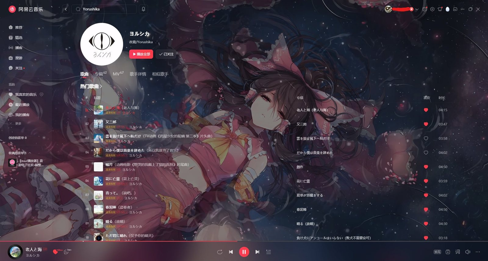
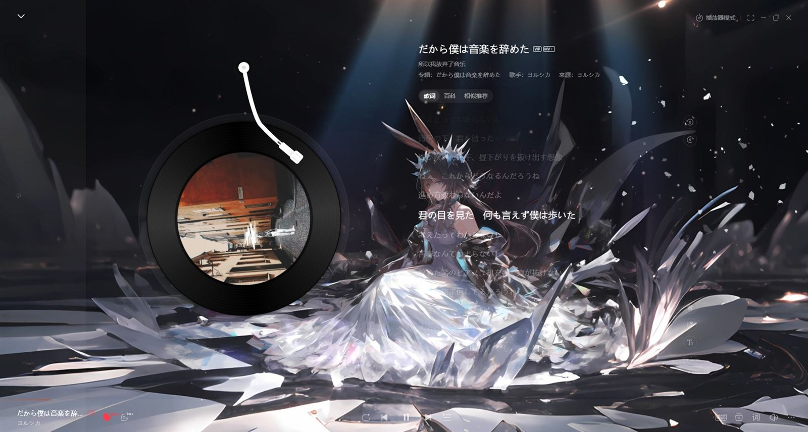
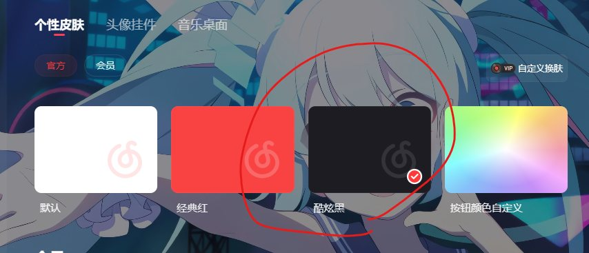

# 网易云 × Wallpaper Engine

> 把 Wallpaper Engine 的动态壁纸塞进网易云音乐 PC 端，**参数面板直接长在 WE 自己的属性页里**。
> 客户端本体零改动 —— 不替换文件、不打补丁、不重分发任何二进制。


**English** — A bridge that puts Wallpaper Engine wallpapers behind the NetEase
CloudMusic desktop client. It attaches to the app's own CEF debug port, drops a
wallpaper layer beneath the existing `z-index:-100` background, and reads its
parameters from Wallpaper Engine's native property panel. No binary is patched or
redistributed. Windows only.





---

## 先做这一步：皮肤换成「酷炫黑」



> 默认 / 浅色皮肤的背景接近白色，壁纸叠上去会被冲得很淡，像蒙了层雾。
> **先切到「酷炫黑」**（`头像 → 个性皮肤 → 酷炫黑`），底色够深，壁纸才通透、文字也清楚。

## 开始用

```bat
install.cmd     :: 编译两个原生小工具 + 给每张壁纸写入「网易云背景」分组（一次）
start.cmd       :: 启动桥接，之后在 WE 里选任意壁纸即可
```

想撤销：`uninstall.cmd`。

遇到问题、或者想要一步步的手把手版本 → **[INSTALL.md](INSTALL.md)（中文安装说明）**。

> 客户端如果已经开着、但没带调试端口，`start.cmd` 会自动重启它（约 5–10 秒恢复）。
> 不想被打断就加 `--no-relaunch`。

## 它做了什么

网易云 PC 端是个 CEF 应用，界面整层打包在 `orpheus.ntpk`（未加密 ZIP，1411 个文件）。本项目：

1. 用客户端自己透传的 `--remote-debugging-port` 挂上 DevTools 协议；
2. 找到 `AppBackground` 那个 `z-index:-100` 的合成层，把壁纸作为兄弟图层插进去；
3. 原生遮罩继续压在壁纸上面，卡片、封面、歌词照常显示；
4. 轮询 Wallpaper Engine 的 `config.json`，把面板里的值映射成 CSS。

```
Wallpaper Engine                          NetEase CloudMusic
┌──────────────────┐                      ┌──────────────────────────┐
│ 属性面板          │  config.json         │  CEF renderer            │
│ ne_opacity ──────┼────────────────────▶ │  ┌────────────────────┐  │
│ ne_dim  ne_tint  │   250ms poll         │  │ #__neVideo  z:-100 │  │
│ ne_blur ne_fit   │                      │  ├────────────────────┤  │
└──────────────────┘                      │  │ 原生 .before 遮罩   │  │
        │ Scene                           │  ├────────────────────┤  │
        ▼                                 │  │ UI（卡片 / 歌词）   │  │
┌──────────────────┐  PrintWindow         │  └────────────────────┘  │
│ WPEOverlapped-   │ ─ JPEG ─▶ MJPEG ────▶│           ▲              │
│ Wallpaper 离屏   │   127.0.0.1:2001     │           │ CDP inject   │
└──────────────────┘                      └───────────┴──────────────┘
```

细节见 [docs/how-it-works.md](docs/how-it-works.md)。

## 参数

面板里的「网易云背景」分组，9 个控件：

| 键 | 类型 | 作用 |
|---|---|---|
| `ne_enabled` | 开关 | 总开关，关掉即回原生外观 |
| `ne_opacity` | 0–100 | 壁纸不透明度 |
| `ne_dim` | 0–100 | 明暗调节（叠一层黑） |
| `ne_tint` | 颜色 | 染色 |
| `ne_tintstrength` | 0–100 | 染色强度 |
| `ne_blur` | 0–60 px | 背景模糊 |
| `ne_fit` | cover / contain / fill / tile | 铺满方式 |
| `ne_audio` | 开关 | 播放壁纸音轨（仅 Video，尚未验证） |
| `ne_scenevolume` | 0–100 | Scene 壁纸音量（靠 CoreAudio 的 per-process session；关掉总开关时自动置 0） |

改完点面板底部的「确认」才写入 `config.json`，之后约 0.1 秒生效。

## 能力与边界

| | |
|---|---|
| 背景接管 | 主界面 / 歌单 / 黑胶歌词页全程透出壁纸，卡片与文字保持在上层 |
| 壁纸类型 | **Video**（原生 `<video>`）、**Scene**（捕获 WE 渲染窗口 → MJPEG）、**Web** 暂不支持 |
| 毛玻璃 | 底栏、搜索弹层走 `backdrop-filter`，主题色自动跟随 |
| 生命周期 | 客户端重启自愈；页面刷新 / 路由切换后重新挂载；窗口隐藏时停止绘制 |
| 新增壁纸 | 控制器运行期间盯创意工坊目录，新下载的壁纸自动补上分组 |

**改不了的地方**：桌面歌词、迷你播放器是原生分层窗口，不在 CEF 里，CSS 碰不到。

## 目录结构

```
install.cmd / uninstall.cmd / start.cmd    批处理入口
INSTALL.md                                 中文安装说明（手把手 + 排障）
src/main.mjs                              控制器：挂 CDP、注入、轮询配置
src/inject.js                             页面层：样式 + 壁纸图层 + 黑胶页/iframe 处理
src/we-config.mjs                         读 WE 的 config.json
src/we-panel.mjs                          往壁纸 project.json 写入 / 移除属性分组
src/paths.mjs                             自动探测客户端与 WE 的安装位置
src/media-server.mjs                      本地 HTTP + Range，给 <video> 供片
src/scene-capture.mjs                     Scene：pop-out 窗口 → 抓帧 → MJPEG
native/*.cs + build.cmd                   用系统自带 csc.exe 编译的小工具
docs/how-it-works.md                      原理长文
BUGS.md                                   已知问题清单
```

## 自定义路径

默认自动探测（注册表 → 常见安装位置 → Steam 库）。探测不到就复制 `config.example.json`
为 `config.json` 手动填，或用环境变量 `NETEASE_EXE` / `WE_ROOT` / `WE_WORKSHOP`。

Wallpaper Engine 把配置存在一个**以 Windows 账户名命名的段**里（`"Rain": {...}`），
这个名字每台机器都不一样。程序会自动挑「有壁纸配置的那一段」，优先匹配当前登录账户；
如果同一台机器有多个账户段需要指定，用 `weProfile` 或环境变量 `WE_PROFILE` 强制选择。

## 已知限制

- **桌面歌词、迷你播放器改不了**（原生窗口）。
- **Scene 壁纸有帧率上限**：1080p 实测 ~57 fps，4K 掉到 ~17 fps（抓帧 + JPEG 编码是瓶颈）。
- **Web 类壁纸不支持**，需要单独的浏览器上下文。
- 客户端大版本更新后，带哈希的 class 名可能要重新对一遍。
- 首次切到 Scene 壁纸时，WE 的 pop-out 窗口会闪约 10–20 ms（一帧）。
- 面板的实时性只到「确认」为止 —— WE 拖动滑块时不写盘，见下。

## 几个踩过的坑

- **WE 会复用已存在的 pop-out**：再发一次 `openWallpaper -playInWindow` 只换内容，窗口句柄和位置都不变。所以换 Scene 壁纸**不要关旧窗口**，关了再开就会有一个大窗口停在屏幕中间。
- **窗口必须保持可见**（只是挪到 `-4000,-4000`）：`SW_HIDE` 之后窗口不参与合成，`PrintWindow` 拿到的是一整张黑图。
- **抓帧进程要比 `openWallpaper` 先启动**：它自己启动要 ~150 ms，WE 80 ms 就把窗口显示出来了。
- **`openWallpaper` 不接受 `-x` / `-y`**，传了也被忽略（窗口永远开在 `0,0`）。
- **拖动滑块时 WE 不写 `config.json`**：滑块每次变化只发 `applySingleProperty` 给后端和渲染器，落盘只发生在点「确认」时。所以拖动过程无法实时同步，确认后约 0.1 秒生效。
- **嵌入页是跨域 iframe**：「个性皮肤 / 头像挂件 / 音乐桌面」本质是 `https://music.163.com/st/vippendant`。注入脚本在子框架里也会跑，早先会在里面再建一层背景，页面就成了死黑的板子；现在子框架只塞一行 `html,body{background:transparent}` 然后让路。
- **`Page.addScriptToEvaluateOnNewDocument` 只对之后新建的文档生效**：改完 `inject.js` 必须给当前文档再 `Runtime.evaluate` 一次，否则页面里跑的还是旧闭包。

## 免责

仅供个人学习与本地使用。不修改、不重分发客户端任何文件，不提供任何壁纸资源；
壁纸版权归原作者所有。使用本工具产生的任何后果由使用者自行承担。

## License

MIT
